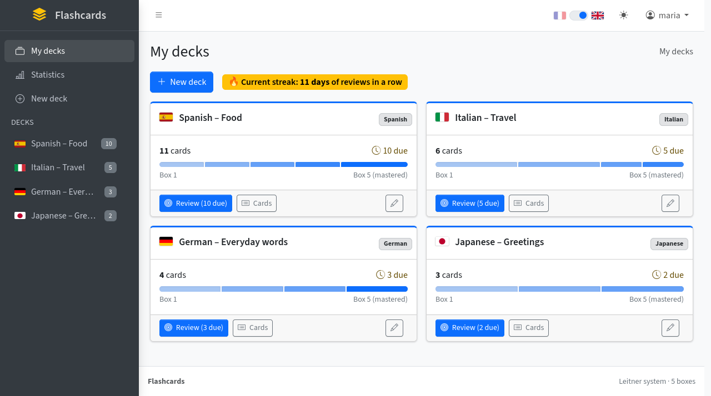
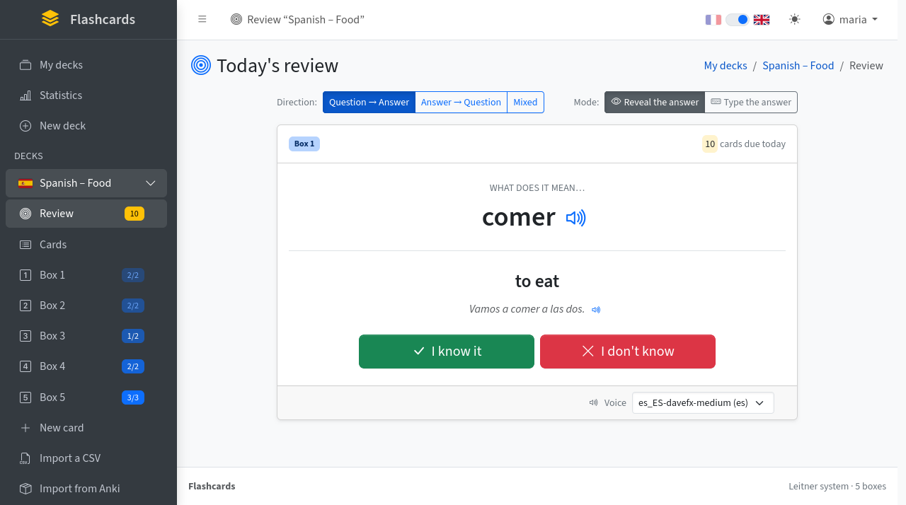
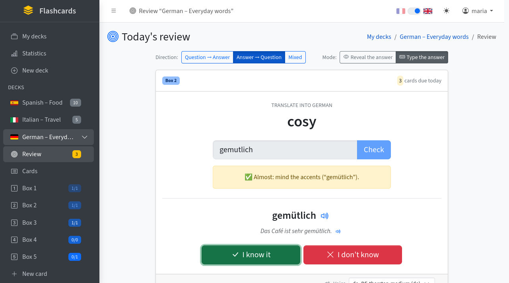
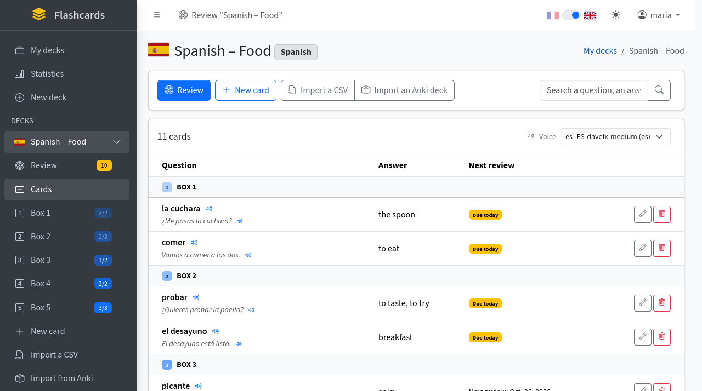
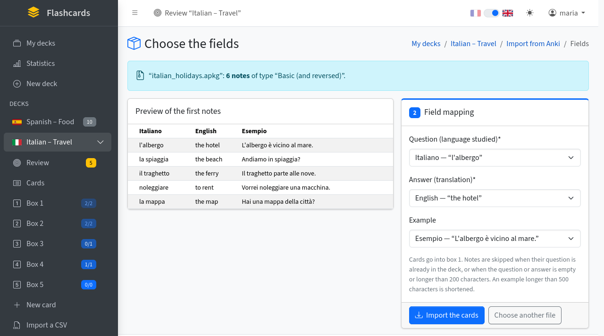
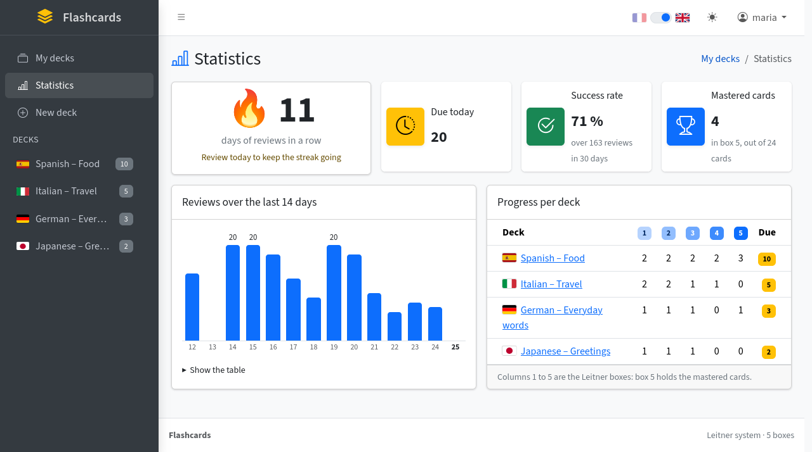
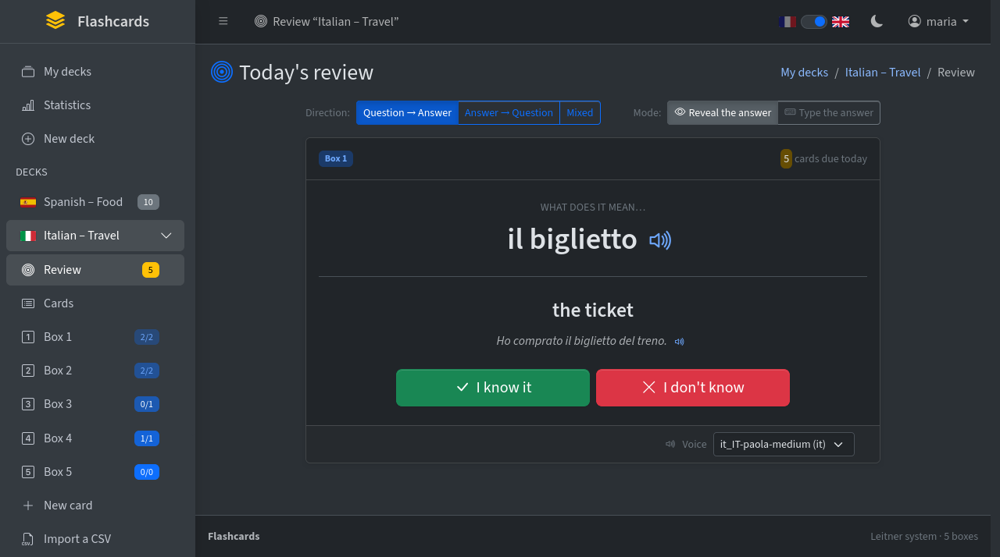

# Flashcards

Application web de flashcards pour apprendre le vocabulaire de langues étrangères (anglais, espagnol, allemand, italien, portugais, et une vingtaine d'autres), écrite avec [Django](https://www.djangoproject.com/).

Elle repose sur le **système de Leitner** : chaque carte avance d'une boîte quand on la connaît et revient à la première quand on se trompe. Plus une carte est dans une boîte élevée, plus sa prochaine révision est espacée.

Le projet est parti du tutoriel [Real Python « Build a Flashcards App With Django »](https://realpython.com/django-flashcards-app/), puis a été enrichi.

## Fonctionnalités

- **Comptes utilisateurs** : inscription, connexion ; chacun ne voit que ses propres cartes.
- **Paquets par langue** : regroupez vos cartes en paquets (« Anglais – verbes », « Italien – cuisine »…), repérés par le drapeau de leur langue. Les langues courantes sont proposées en premier, suivies d'une vingtaine d'autres (arabe, chinois, japonais, russe…), et la liste s'allonge facilement (voir [Ajouter une langue](#ajouter-une-langue)).
- **Révisions espacées** : seules les cartes dues aujourd'hui sont proposées.
- **Deux sens de révision** : question → réponse, réponse → question, ou mélangé.
- **Deux modes de réponse** :
  - **révéler** la réponse puis dire si on la savait ;
  - **taper** la réponse. La comparaison ignore les majuscules et la ponctuation, et signale les fautes d'accent.
- **Phrase d'exemple** facultative sur chaque carte.
- **Prononciation** 🔊 par la synthèse vocale du navigateur, avec une voix anglaise ou espagnole selon le paquet. La meilleure voix installée est choisie automatiquement, et on peut en choisir une autre. Sous Linux, des voix naturelles s'installent avec [Piper](#des-voix-naturelles-sous-linux-avec-piper).
- **Import CSV** pour ajouter beaucoup de cartes d'un coup.
- **Import de paquets Anki** (`.apkg`), par exemple les paquets partagés sur AnkiWeb, en choisissant les champs à utiliser.
- **Statistiques** :
  - série de jours de révision d'affilée 🔥 ;
  - taux de réussite ;
  - graphique des 14 derniers jours ;
  - progression par paquet.
- **Recherche** dans les cartes et **pagination**.
- **Raccourcis clavier** pour réviser vite, et affichage adapté au mobile.
- Interface **en français ou en anglais** (interrupteur 🇫🇷 / 🇬🇧 en haut à droite, ou sous le formulaire de connexion), construite avec [AdminLTE](https://adminlte.io/) : menu latéral avec vos paquets et leurs boîtes, thème **clair, sombre ou automatique** (menu ☀ en haut à droite), formulaires mis en forme avec Bootstrap.

## Screenshots

*The interface is available in English and French. The cards below come from a demo account.*

### Your decks

Each deck is studied in one language, shown by its flag. The bar shows how its cards spread over the five Leitner boxes, from box 1 (new or forgotten) to box 5 (mastered). The sidebar lists your decks with the number of cards due today, and the switch at the top right turns the interface from French to English.



### Reviewing

Only the cards due today are shown. Read the word, think of the answer, then press **Show the answer** (or <kbd>Space</kbd>). The answer comes with its example sentences. Each one can be heard with 🔊, in the voice chosen at the bottom of the card. Then say whether you knew it: **I know it** (<kbd>→</kbd>) moves the card up one box, so you'll see it again later; **I don't know** (<kbd>←</kbd>) sends it back to box 1, for today.



You can also review from the translation (**Answer → Question**) or mix both directions, and **type the answer** instead of revealing it. Case and punctuation are ignored, and a missing accent is pointed out rather than counted as a mistake:



### Cards

The cards of a deck, grouped by box, with their next review date. Search them, add them one by one, or import many at once from a CSV file or an Anki deck.



### Importing an Anki deck

Pick an `.apkg` file, either downloaded from [AnkiWeb](https://ankiweb.net/shared/decks) or exported from Anki, then choose which of its fields becomes the question, the answer and the example. A preview of the first notes helps you choose.



### Statistics

Your streak of days with reviews, your success rate, the reviews of the last two weeks and the progress of each deck.



### Dark theme

Light, dark, or following your system, from the ☀ menu at the top right.



## Prérequis

- **Python 3.12 ou plus récent** (exigé par Django 6.1)
- **git**

## Installation

### 1. Récupérer le projet

```bash
git clone https://github.com/arribo44/Flashcards.git
cd Flashcards
```

### 2. Créer un environnement virtuel et installer les dépendances

Sous Linux ou macOS :

```bash
python3 -m venv .venv
source .venv/bin/activate
pip install -r requirements.txt
```

Sous Windows (PowerShell) :

```powershell
py -m venv .venv
.venv\Scripts\Activate.ps1
pip install -r requirements.txt
```

Les commandes `python …` des étapes suivantes supposent que l'environnement virtuel est activé.

### 3. Configurer l'application

La configuration sensible n'est pas dans le code : elle est lue dans un fichier `.env` à la racine du projet. Ce fichier n'est **jamais** envoyé sur GitHub, car il est listé dans `.gitignore`.

Copiez le modèle :

```bash
cp .env.example .env
```

Générez une clé secrète :

```bash
python -c "from django.core.management.utils import get_random_secret_key; print(get_random_secret_key())"
```

Puis ouvrez `.env` et complétez-le :

```ini
DJANGO_SECRET_KEY=collez-ici-la-clé-générée
DJANGO_DEBUG=True
DJANGO_ALLOWED_HOSTS=localhost,127.0.0.1
```

| Variable | Rôle | Valeur par défaut |
|---|---|---|
| `DJANGO_SECRET_KEY` | Clé secrète de Django (sessions, jetons CSRF…). **Obligatoire** : l'application refuse de démarrer sans elle. | aucune |
| `DJANGO_DEBUG` | `True` pour développer en local (pages d'erreur détaillées). À laisser à `False` en production. | `False` |
| `DJANGO_ALLOWED_HOSTS` | Noms de domaine autorisés, séparés par des virgules. | `localhost,127.0.0.1` |

### 4. Créer la base de données

```bash
python manage.py migrate
```

La base SQLite `db.sqlite3` est créée à la racine du projet. Elle reste sur votre machine et n'est pas versionnée.

### 5. (Facultatif) Créer un administrateur

```bash
python manage.py createsuperuser
```

Ce compte donne accès à l'interface d'administration (`/admin/`). Pour simplement utiliser l'application, un compte créé depuis la page d'inscription suffit.

### 6. Lancer l'application

```bash
python manage.py runserver
```

Ouvrez <http://127.0.0.1:8000/>, créez un compte, et c'est parti.

## Utilisation

### Créer des cartes

1. Sur la page **Mes paquets**, cliquez sur **✨ Nouveau paquet**. Donnez-lui un nom et choisissez sa langue.
2. Dans le paquet, ajoutez des cartes une par une avec **✨ Nouvelle carte**, ou importez-les avec **📥 Importer un CSV** ou **📦 Importer un paquet Anki**.

Les champs d'une carte :

- la **question**, dans la langue étudiée, par exemple *Hectic*. C'est elle que lit le bouton 🔊 ;
- la **réponse**, en français, par exemple *Intense* ;
- l'**exemple**, facultatif, par exemple *It's been a hectic week.* Pour donner plusieurs phrases, séparez-les par un point-virgule (`;`) : elles s'affichent alors une par ligne, chacune avec son bouton 🔊. C'est le cas des paquets Anki qui regroupent leurs exemples dans un seul champ.

### Importer un fichier CSV

Le fichier contient une carte par ligne, avec deux ou trois colonnes : question, réponse et, si vous le voulez, un exemple.

```csv
question;réponse;exemple
Hectic;Intense;It's been a hectic week.
To sprinkle;Saupoudrer;
Cradle;Berceau;
```

- **Séparateur** : virgule, point-virgule ou tabulation. Il est détecté automatiquement.
- **Encodage** : UTF-8, ou le format « CSV (séparateur : point-virgule) » d'Excel sous Windows.
- **En-tête** : une première ligne commençant par `question` est ignorée.
- **Doublons** : les questions déjà présentes dans le paquet sont ignorées.
- **Tout ou rien** : si une ligne est invalide (réponse manquante, texte trop long), **rien n'est importé** et les lignes en erreur sont indiquées.
- **Limites** : 1 Mo par fichier, 200 caractères pour la question et la réponse, 500 pour l'exemple.

### Importer un paquet Anki

L'application lit directement les fichiers `.apkg` d'[Anki](https://apps.ankiweb.net/), par exemple les milliers de paquets partagés gratuitement sur [AnkiWeb](https://ankiweb.net/shared/decks). Il n'est pas nécessaire d'installer Anki.

1. Téléchargez un paquet (`.apkg`) depuis AnkiWeb, ou exportez-en un depuis Anki (**Fichier → Exporter… → « Paquet de cartes Anki (.apkg) »**).
2. Dans un paquet de l'application, cliquez sur **📦 Importer un paquet Anki**, puis :
   - choisissez le paquet dans la liste **Paquet du dossier**, qui montre les fichiers `.apkg` rangés dans `DATAS/ANKI/` : rien n'est envoyé, l'application les lit directement sur le disque ;
   - ou envoyez un fichier avec **Parcourir…**.
3. L'application affiche un aperçu des premières notes. Choisissez quel champ devient la **question** (langue étudiée), la **réponse** (traduction) et, si vous voulez, l'**exemple**. Si le paquet contient plusieurs types de notes, choisissez aussi lequel importer.
4. Cliquez sur **Importer les cartes**.

Ce qui est repris, et ce qui ne l'est pas :

- **Texte** : il est repris sans mise en forme. Le HTML, les marques de texte à trous (`{{c1::…}}`) et les références aux sons sont retirés.
- **Médias** : les sons et les images sont ignorés. Le bouton 🔊 lit les cartes avec la synthèse vocale du navigateur.
- **Progression** : celle d'Anki n'est pas reprise. Les cartes arrivent en boîte 1, à réviser tout de suite.
- **Notes ignorées** : celles dont la question existe déjà dans le paquet, ou dont la question ou la réponse est vide ou dépasse 200 caractères. Le message de fin indique combien. Un exemple de plus de 500 caractères est raccourci, sans perdre la carte.
- **Limites** : 300 Mo par fichier et 20 000 notes par import.
- **Formats** : ceux d'Anki 2.1.50 et plus récents (base compressée) comme les anciens.

Bon à savoir :

- **Langue des réponses** : la plupart des paquets d'AnkiWeb sont faits pour des anglophones (anglais ↔ espagnol, anglais ↔ définition anglaise). Pour avoir les réponses en français, cherchez par exemple « French English » ou « français anglais ».
- **Dossier des paquets** : `DATAS/` est ignoré par git, les paquets qui s'y trouvent ne sont donc jamais publiés sur GitHub. Pour utiliser un autre dossier, indiquez-le dans `.env` : `ANKI_FOLDER=/chemin/vers/mes/paquets`.
- **Droits** : chaque paquet partagé a sa propre licence : ne les publiez pas avec le projet.

### Réviser

Cliquez sur **🎯 Réviser** pour lancer la révision du jour. Elle pioche parmi toutes les cartes dues du paquet. Chaque boîte peut aussi être révisée séparément depuis la barre de navigation, où `🗃 Boîte 2 3/5` signifie 3 cartes à réviser sur 5 dans la boîte.

En haut de la page de révision, vous choisissez :

- **le sens** : Question → Réponse, Réponse → Question, ou Mélangé ;
- **le mode** : Révéler la réponse, ou Taper la réponse.

Ces choix sont mémorisés pendant votre session.

En mode saisie, plusieurs réponses séparées par `,`, `;` ou `/` sont acceptées. Par exemple, « Se trémousser, gigoter » accepte les deux. Le bouton correspondant au verdict est présélectionné : <kbd>Entrée</kbd> le valide, mais vous pouvez cliquer sur l'autre si vous estimez que votre réponse était juste.

Raccourcis clavier :

| Touche | Action |
|---|---|
| <kbd>Espace</kbd> | Afficher la réponse |
| <kbd>→</kbd> | Je sais |
| <kbd>←</kbd> | Je ne sais pas |
| <kbd>P</kbd> | Écouter la prononciation |

### Le rythme des révisions

| La carte arrive en… | Boîte 1 | Boîte 2 | Boîte 3 | Boîte 4 | Boîte 5 |
|---|---|---|---|---|---|
| Prochaine révision | le jour même | 1 jour | 3 jours | 7 jours | 14 jours |

- **Si vous savez la réponse**, la carte monte d'une boîte. En boîte 5, elle y reste.
- **Si vous ne la savez pas**, elle retourne en boîte 1 et revient dans la même séance.
- **Nouvelles cartes** : elles commencent en boîte 1, à réviser tout de suite.
- **Réglage** : les délais se modifient dans `REVIEW_INTERVALS`, dans [`cards/models.py`](cards/models.py).

La progression est commune aux deux sens de révision : une carte ratée en sens inverse repart en boîte 1.

### Statistiques

La page **📊 Statistiques** affiche :

- la série de jours de révision d'affilée et votre record ;
- le nombre de cartes à réviser aujourd'hui ;
- le taux de réussite sur 30 jours ;
- les cartes maîtrisées (en boîte 5) ;
- un graphique des révisions des 14 derniers jours, avec le détail en tableau ;
- la répartition des cartes par boîte pour chaque paquet.

Chaque réponse est enregistrée dans un historique qui est conservé même si la carte est supprimée.

## La voix de prononciation

### D'où vient la voix

Le bouton 🔊 et la touche <kbd>P</kbd> utilisent la **synthèse vocale du navigateur**. L'application ne contient aucune voix : chaque appareil prononce les cartes avec **les voix installées sur lui**, et la qualité dépend donc de l'appareil.

- **Windows, macOS, Android, iPhone/iPad** : les voix du système sont en général de bonne qualité. On peut en ajouter dans les réglages du système, rubrique « Voix », « Synthèse vocale » ou « Contenu énoncé ».
- **Microsoft Edge**, sur tous les systèmes y compris Linux : il ajoute ses propres voix « Online (Natural) », très naturelles. Elles nécessitent une connexion internet, et le texte prononcé est envoyé à Microsoft.
- **Linux** : Firefox et Chromium utilisent par défaut **eSpeak NG**, dont la voix est très robotique. La solution recommandée est Piper, décrit ci-dessous.

### Choisir la voix dans l'application

L'application choisit automatiquement la meilleure voix installée pour la langue du paquet. Elle préfère, dans l'ordre :
1. les voix Piper ;
2. les voix « Natural », « Neural », « Online », « Google », « RHVoice »… ;
3. en dernier recours, eSpeak.

Pour en choisir une autre, utilisez le menu **🔊 Voix**, sur la page de révision et dans la liste des cartes. Il propose toutes les voix du navigateur pour la langue du paquet, et fait entendre la voix choisie.

Le choix est **mémorisé dans ce navigateur, pour chaque langue** : un choix pour l'anglais vaut pour tous les paquets d'anglais. Il n'est ni enregistré sur le serveur ni partagé avec d'autres appareils.

Le menu n'apparaît que si le navigateur propose au moins une voix pour la langue du paquet.

### Des voix naturelles sous Linux avec Piper

> 🇬🇧 *English version: [Natural voices on Linux with Piper](#natural-voices-on-linux-with-piper).*

[Piper](https://github.com/rhasspy/piper) est un moteur de synthèse vocale **neuronal** qui fonctionne **hors ligne** : rien n'est envoyé sur internet. Sa voix est beaucoup plus naturelle que celle d'eSpeak.

On l'installe dans son dossier personnel, sans `sudo` ni modification du système. On le branche ensuite sur **speech-dispatcher**, le service de synthèse vocale de Linux qu'utilisent Firefox et Chromium.

Les voix installées ci-dessous couvrent les cinq langues courantes des paquets (**anglais**, **espagnol**, **italien**, **allemand**, **portugais**), ainsi que le **français**. Le français est nécessaire parce que Piper devient le moteur par défaut (étape 4) : sans voix française, les applications et les pages web en français n'auraient plus de voix. Pour les autres langues (arabe, chinois…), voir [Ajouter une langue ou une autre voix](#ajouter-une-langue-ou-une-autre-voix).

**Ce qui est installé**

| Élément | Emplacement | Taille |
|---|---|---|
| Moteur Piper (version autonome 2023.11.14-2) | `~/.local/share/piper/piper/` | 52 Mo |
| Voix anglaise : `en_GB-cori-medium` (anglais britannique, voix féminine) | `~/.local/share/piper/voices/` | 63 Mo |
| Voix espagnole : `es_ES-davefx-medium` (espagnol d'Espagne, voix masculine) | `~/.local/share/piper/voices/` | 63 Mo |
| Voix française : `fr_FR-siwis-medium` (français, voix féminine) | `~/.local/share/piper/voices/` | 63 Mo |
| Voix italienne : `it_IT-paola-medium` (italien, voix féminine) | `~/.local/share/piper/voices/` | 63 Mo |
| Voix allemande : `de_DE-thorsten-medium` (allemand, voix masculine) | `~/.local/share/piper/voices/` | 63 Mo |
| Voix portugaise : `pt_PT-tugao-medium` (portugais du Portugal, voix masculine) | `~/.local/share/piper/voices/` | 63 Mo |
| Module Piper pour speech-dispatcher | `~/.config/speech-dispatcher/modules/piper-generic.conf` | 1 Ko |
| Configuration personnelle de speech-dispatcher (Piper par défaut) | `~/.config/speech-dispatcher/speechd.conf` | 14 Ko |

Au total, environ **430 Mo**. Chaque voix supplémentaire en qualité « medium » ajoute environ 63 Mo.

**Rien de tout cela ne va dans git.** Ces fichiers font partie de votre ordinateur, pas de l'application. Ils sont trop gros pour GitHub, et chaque appareil a besoin de ses propres voix. Piper n'améliore la voix que sur l'ordinateur où il est installé : sur un téléphone, ce sont les voix du téléphone qui sont utilisées.

**Prérequis** : un Linux 64 bits (x86_64) avec speech-dispatcher, présent par défaut sur Linux Mint et Ubuntu, et la commande `aplay` (paquet `alsa-utils`, en général déjà installé). Vérification :

```bash
uname -m           # doit afficher x86_64
spd-say -O         # liste les moteurs de speech-dispatcher
command -v aplay   # doit afficher /usr/bin/aplay
```

> ⚠️ N'utilisez pas `sudo apt install piper` : ce paquet est un outil de configuration de souris de jeu, sans rapport avec la synthèse vocale.

#### 1. Installer le moteur

```bash
mkdir -p ~/.local/share/piper/voices
cd ~/.local/share/piper
curl -L -o piper_linux_x86_64.tar.gz \
  https://github.com/rhasspy/piper/releases/download/2023.11.14-2/piper_linux_x86_64.tar.gz
tar -xzf piper_linux_x86_64.tar.gz
rm piper_linux_x86_64.tar.gz
./piper/piper --version   # doit afficher 1.2.0
```

#### 2. Télécharger les voix

Les voix viennent du [catalogue officiel de Piper](https://huggingface.co/rhasspy/piper-voices). Chaque voix est composée de deux fichiers : le modèle `.onnx` et sa configuration `.onnx.json`.

```bash
cd ~/.local/share/piper/voices
BASE=https://huggingface.co/rhasspy/piper-voices/resolve/v1.0.0

# Anglais britannique
curl -L -O $BASE/en/en_GB/cori/medium/en_GB-cori-medium.onnx
curl -L -O $BASE/en/en_GB/cori/medium/en_GB-cori-medium.onnx.json

# Espagnol d'Espagne
curl -L -O $BASE/es/es_ES/davefx/medium/es_ES-davefx-medium.onnx
curl -L -O $BASE/es/es_ES/davefx/medium/es_ES-davefx-medium.onnx.json

# Français
curl -L -O $BASE/fr/fr_FR/siwis/medium/fr_FR-siwis-medium.onnx
curl -L -O $BASE/fr/fr_FR/siwis/medium/fr_FR-siwis-medium.onnx.json

# Italien
curl -L -O $BASE/it/it_IT/paola/medium/it_IT-paola-medium.onnx
curl -L -O $BASE/it/it_IT/paola/medium/it_IT-paola-medium.onnx.json

# Allemand
curl -L -O $BASE/de/de_DE/thorsten/medium/de_DE-thorsten-medium.onnx
curl -L -O $BASE/de/de_DE/thorsten/medium/de_DE-thorsten-medium.onnx.json

# Portugais du Portugal : le nom d'origine contient un « ã » (tugão),
# enregistré ici sans accent pour éviter les soucis d'encodage
curl -L -o pt_PT-tugao-medium.onnx "$BASE/pt/pt_PT/tug%C3%A3o/medium/pt_PT-tug%C3%A3o-medium.onnx"
curl -L -o pt_PT-tugao-medium.onnx.json "$BASE/pt/pt_PT/tug%C3%A3o/medium/pt_PT-tug%C3%A3o-medium.onnx.json"
```

Test, qui doit prononcer la phrase sur vos haut-parleurs :

```bash
echo "It's been a hectic week." | ~/.local/share/piper/piper/piper \
  --model ~/.local/share/piper/voices/en_GB-cori-medium.onnx --output_raw --quiet \
  | aplay -q -r 22050 -f S16_LE -t raw -
```

#### 3. Brancher Piper sur speech-dispatcher

Créez le fichier `~/.config/speech-dispatcher/modules/piper-generic.conf` :

```bash
mkdir -p ~/.config/speech-dispatcher/modules
nano ~/.config/speech-dispatcher/modules/piper-generic.conf
```

avec ce contenu :

```text
# Piper neural voices for speech-dispatcher (used by Firefox for the web page speech API).
Debug 0

GenericExecuteSynth \
"printf %s \'$DATA\' | $HOME/.local/share/piper/piper/piper --model $HOME/.local/share/piper/voices/$VOICE.onnx --output_raw --quiet | aplay -q -r 22050 -f S16_LE -t raw -"

GenericCmdDependency "aplay"

# Read whole sentences in one go instead of pausing at every comma
GenericDelimiters ".?!"
GenericMaxChunkLength 500

GenericLanguage "en" "en" "utf-8"
GenericLanguage "es" "es" "utf-8"
GenericLanguage "fr" "fr" "utf-8"
GenericLanguage "it" "it" "utf-8"
GenericLanguage "de" "de" "utf-8"
GenericLanguage "pt" "pt" "utf-8"

AddVoice "en" "FEMALE1" "en_GB-cori-medium"
AddVoice "es" "MALE1" "es_ES-davefx-medium"
AddVoice "fr" "FEMALE1" "fr_FR-siwis-medium"
AddVoice "it" "FEMALE1" "it_IT-paola-medium"
AddVoice "de" "MALE1" "de_DE-thorsten-medium"
AddVoice "pt" "MALE1" "pt_PT-tugao-medium"

DefaultVoice "en_GB-cori-medium"
```

speech-dispatcher détecte ce module tout seul. Redémarrez-le (il se relance automatiquement à la première demande) et vérifiez :

```bash
pkill -u "$USER" -f /usr/bin/speech-dispatcher
spd-say -O                                         # « piper-generic » doit apparaître
spd-say -o piper-generic -L                        # liste les six voix
spd-say -o piper-generic -l en "It's been a hectic week."
```

#### 4. Faire de Piper le moteur par défaut (indispensable pour Firefox)

**Firefox ne propose que les voix du moteur _par défaut_ de speech-dispatcher**, qui est eSpeak. Même installé, Piper reste donc invisible dans le navigateur : la liste des voix ne contient que des milliers de variantes d'eSpeak, toutes robotiques. Il faut faire de Piper le moteur par défaut.

On le fait dans une configuration personnelle de speech-dispatcher. Elle **remplace** celle du système, d'où la copie de départ :

```bash
cp /etc/speech-dispatcher/speechd.conf ~/.config/speech-dispatcher/speechd.conf
cat >> ~/.config/speech-dispatcher/speechd.conf <<'EOF'

# Firefox only lists the voices of the default module: make it Piper
DefaultModule piper-generic
EOF
pkill -u "$USER" -f /usr/bin/speech-dispatcher
```

Vérification : la liste des voix du moteur par défaut, celle que voit Firefox, doit maintenant afficher les six voix Piper.

```bash
spd-say -L
spd-say -y es_ES-davefx-medium "¿Qué tal? Vamos a comer."
spd-say -l fr "Bonjour, les voix naturelles fonctionnent."
```

Conséquence : Firefox et les autres applications qui passent par speech-dispatcher, comme le lecteur d'écran Orca, n'utilisent plus que les voix Piper installées. Une langue sans voix Piper serait lue avec la voix par défaut (`DefaultVoice`, l'anglaise). Ajoutez une voix Piper pour chaque langue dont vous avez besoin (voir plus bas), ou envoyez cette langue vers eSpeak en ajoutant par exemple `LanguageDefaultModule "de" "espeak-ng"` à `speechd.conf`.

#### 5. Utiliser Piper dans l'application

1. **Fermez complètement Firefox puis rouvrez-le**, pour qu'il recharge la liste des voix.
2. Rechargez la page de l'application avec <kbd>Ctrl</kbd>+<kbd>Maj</kbd>+<kbd>R</kbd>.
3. Ouvrez la page de révision d'un paquet : le menu **🔊 Voix**, en bas de la carte, doit proposer la voix Piper de la langue du paquet (`en_GB-cori-medium` pour l'anglais, `it_IT-paola-medium` pour l'italien…), déjà sélectionnée. Le même menu se trouve en haut de la liste des cartes du paquet. Il est masqué quand aucune voix n'est installée pour la langue du paquet.
4. Cliquez sur 🔊 à côté d'un mot. Chaque lecture démarre avec environ une seconde de délai, le temps de charger la voix.

#### Ajouter une langue ou une autre voix

Chaque langue de paquet a besoin de sa propre voix Piper : sans elle, le menu **🔊 Voix** reste masqué et les cartes sont lues avec la voix anglaise par défaut. Le catalogue propose des dizaines de langues et plusieurs voix par langue, que l'on peut écouter sur la [page de démonstration de Piper](https://rhasspy.github.io/piper-samples/). La liste complète des voix, avec leur chemin, est dans le fichier [`voices.json`](https://huggingface.co/rhasspy/piper-voices/blob/v1.0.0/voices.json) du catalogue.

Exemple avec la voix russe `ru_RU-irina-medium` :

1. Trouvez le chemin de la voix dans le catalogue. Il suit toujours le modèle `<langue>/<langue_PAYS>/<nom>/<qualité>/<langue_PAYS>-<nom>-<qualité>`, ici `ru/ru_RU/irina/medium/ru_RU-irina-medium`.

2. Téléchargez ses deux fichiers dans `~/.local/share/piper/voices/` :

   ```bash
   cd ~/.local/share/piper/voices
   BASE=https://huggingface.co/rhasspy/piper-voices/resolve/v1.0.0
   curl -L -O $BASE/ru/ru_RU/irina/medium/ru_RU-irina-medium.onnx
   curl -L -O $BASE/ru/ru_RU/irina/medium/ru_RU-irina-medium.onnx.json
   ```

   Si le nom de la voix contient un caractère accentué (comme `pt_PT-tugão`), écrivez-le encodé dans l'adresse (`tug%C3%A3o`) et enregistrez le fichier sans accent avec `curl -L -o pt_PT-tugao-medium.onnx …`.

3. Déclarez-la dans `~/.config/speech-dispatcher/modules/piper-generic.conf`, avec le code de la langue (les deux premières lettres du nom de la voix) :

   ```text
   GenericLanguage "ru" "ru" "utf-8"
   AddVoice "ru" "FEMALE1" "ru_RU-irina-medium"
   ```

   Utilisez `MALE1` pour une voix masculine. Pour une deuxième voix dans la même langue, ajoutez seulement une ligne `AddVoice` (avec `FEMALE2`, `MALE2`…).

4. Redémarrez speech-dispatcher, vérifiez que la voix est listée et qu'elle parle :

   ```bash
   pkill -u "$USER" -f /usr/bin/speech-dispatcher
   spd-say -L
   spd-say -l ru "Привет, как дела?"
   ```

5. Fermez complètement Firefox et rouvrez-le. La voix apparaît dans le menu **🔊 Voix** des paquets de cette langue.

La commande de `piper-generic.conf` joue le son à 22 050 Hz (`aplay -r 22050`), la fréquence des voix de qualité « medium » et « high ». Les voix « x_low » et « low » sont à 16 000 Hz : avec elles, la voix serait trop rapide et trop aiguë. Restez donc sur des voix « medium » ou « high », et en cas de doute vérifiez `"sample_rate"` dans le fichier `.onnx.json` de la voix.

L'application propose déjà une trentaine de langues de paquet. Pour une langue qui n'est pas dans la liste, il faut aussi l'ajouter au code : voir [Ajouter une langue](#ajouter-une-langue).

#### Licences des voix

Chaque voix a sa propre licence, indiquée dans sa fiche `MODEL_CARD`, à côté de ses fichiers dans le catalogue :
- `en_GB-cori-medium` est issue d'enregistrements du domaine public (LibriVox) ;
- `es_ES-davefx-medium`, `de_DE-thorsten-medium` et `pt_PT-tugao-medium` sont sous licence CC0 ;
- `fr_FR-siwis-medium` est sous licence CC-BY 4.0 (attribution obligatoire en cas de redistribution) ;
- `it_IT-paola-medium` a sa licence indiquée sur la page de sa source, liée depuis sa fiche.

Vérifiez la licence avant de redistribuer une voix.

#### En cas de problème

- **`piper-generic` n'apparaît pas dans `spd-say -O`** : vérifiez le nom et l'emplacement du fichier de configuration, et que `aplay` est installé.
- **Aucun son avec `spd-say`** : refaites le test de l'étape 2. S'il ne produit pas de son non plus, le problème vient de la sortie audio et non de speech-dispatcher.
- **La voix reste robotique quelle que soit la voix choisie, et le menu 🔊 Voix est une très longue liste** : Firefox ne voit que les voix d'eSpeak, parce que Piper n'est pas le moteur par défaut. Faites l'étape 4, vérifiez que `spd-say -L` n'affiche que les voix Piper, puis fermez et rouvrez Firefox.
- **Le menu 🔊 Voix ne propose pas la voix Piper** : redémarrez speech-dispatcher, puis fermez complètement Firefox et rouvrez-le.
- **La voix est trop rapide et trop aiguë** : c'est une voix « low » ou « x_low » à 16 000 Hz, alors que la commande joue à 22 050 Hz (voir plus haut). Prenez la version « medium » de la voix.

#### Désinstaller

```bash
rm -rf ~/.local/share/piper
rm ~/.config/speech-dispatcher/modules/piper-generic.conf ~/.config/speech-dispatcher/speechd.conf
pkill -u "$USER" -f /usr/bin/speech-dispatcher
```

### Natural voices on Linux with Piper

> 🇫🇷 *Version française : [Des voix naturelles sous Linux avec Piper](#des-voix-naturelles-sous-linux-avec-piper).*

[Piper](https://github.com/rhasspy/piper) is a **neural** text-to-speech engine that runs **offline**: nothing is sent over the internet. It sounds far more natural than eSpeak, the default voice on Linux.

Piper is installed in your home folder, without `sudo`, then plugged into **speech-dispatcher**, the Linux speech service used by Firefox and Chromium. Nothing goes into git: the voices belong to your computer, not to the app, and each device needs its own.

**Requirements**: 64-bit Linux (x86_64) with speech-dispatcher (installed by default on Linux Mint and Ubuntu) and `aplay` (package `alsa-utils`). Check with `uname -m`, `spd-say -O` and `command -v aplay`.

> ⚠️ Do not run `sudo apt install piper`: that package is a gaming mouse configuration tool.

#### 1. Install the engine

```bash
mkdir -p ~/.local/share/piper/voices
cd ~/.local/share/piper
curl -L -o piper_linux_x86_64.tar.gz \
  https://github.com/rhasspy/piper/releases/download/2023.11.14-2/piper_linux_x86_64.tar.gz
tar -xzf piper_linux_x86_64.tar.gz
rm piper_linux_x86_64.tar.gz
./piper/piper --version   # should print 1.2.0
```

#### 2. Download the voices

Voices come from the [official Piper catalogue](https://huggingface.co/rhasspy/piper-voices). Each voice is two files: the `.onnx` model and its `.onnx.json` configuration (about 63 MB per "medium" voice). These cover the five common deck languages, plus French, which is needed once Piper becomes the default engine (step 4):

```bash
cd ~/.local/share/piper/voices
BASE=https://huggingface.co/rhasspy/piper-voices/resolve/v1.0.0

for VOICE in en/en_GB/cori/medium/en_GB-cori-medium \
             es/es_ES/davefx/medium/es_ES-davefx-medium \
             fr/fr_FR/siwis/medium/fr_FR-siwis-medium \
             it/it_IT/paola/medium/it_IT-paola-medium \
             de/de_DE/thorsten/medium/de_DE-thorsten-medium; do
  curl -L -O $BASE/$VOICE.onnx
  curl -L -O $BASE/$VOICE.onnx.json
done

# European Portuguese: the original name has an "ã" (tugão), saved here without it
curl -L -o pt_PT-tugao-medium.onnx "$BASE/pt/pt_PT/tug%C3%A3o/medium/pt_PT-tug%C3%A3o-medium.onnx"
curl -L -o pt_PT-tugao-medium.onnx.json "$BASE/pt/pt_PT/tug%C3%A3o/medium/pt_PT-tug%C3%A3o-medium.onnx.json"
```

Test (you should hear the sentence):

```bash
echo "It's been a hectic week." | ~/.local/share/piper/piper/piper \
  --model ~/.local/share/piper/voices/en_GB-cori-medium.onnx --output_raw --quiet \
  | aplay -q -r 22050 -f S16_LE -t raw -
```

#### 3. Plug Piper into speech-dispatcher

Create `~/.config/speech-dispatcher/modules/piper-generic.conf` (run `mkdir -p ~/.config/speech-dispatcher/modules` first) with one `GenericLanguage` line and one `AddVoice` line per voice:

```text
# Piper neural voices for speech-dispatcher (used by Firefox for the web page speech API).
Debug 0

GenericExecuteSynth \
"printf %s \'$DATA\' | $HOME/.local/share/piper/piper/piper --model $HOME/.local/share/piper/voices/$VOICE.onnx --output_raw --quiet | aplay -q -r 22050 -f S16_LE -t raw -"

GenericCmdDependency "aplay"

# Read whole sentences in one go instead of pausing at every comma
GenericDelimiters ".?!"
GenericMaxChunkLength 500

GenericLanguage "en" "en" "utf-8"
GenericLanguage "es" "es" "utf-8"
GenericLanguage "fr" "fr" "utf-8"
GenericLanguage "it" "it" "utf-8"
GenericLanguage "de" "de" "utf-8"
GenericLanguage "pt" "pt" "utf-8"

AddVoice "en" "FEMALE1" "en_GB-cori-medium"
AddVoice "es" "MALE1" "es_ES-davefx-medium"
AddVoice "fr" "FEMALE1" "fr_FR-siwis-medium"
AddVoice "it" "FEMALE1" "it_IT-paola-medium"
AddVoice "de" "MALE1" "de_DE-thorsten-medium"
AddVoice "pt" "MALE1" "pt_PT-tugao-medium"

DefaultVoice "en_GB-cori-medium"
```

Then restart speech-dispatcher and check:

```bash
pkill -u "$USER" -f /usr/bin/speech-dispatcher
spd-say -O                     # "piper-generic" should be listed
spd-say -o piper-generic -L    # lists the six voices
```

#### 4. Make Piper the default engine (required for Firefox)

**Firefox only lists the voices of speech-dispatcher's _default_ engine**, which is eSpeak. Make Piper the default in a personal speech-dispatcher configuration, which **replaces** the system one (hence the copy):

```bash
cp /etc/speech-dispatcher/speechd.conf ~/.config/speech-dispatcher/speechd.conf
cat >> ~/.config/speech-dispatcher/speechd.conf <<'EOF'

# Firefox only lists the voices of the default module: make it Piper
DefaultModule piper-generic
EOF
pkill -u "$USER" -f /usr/bin/speech-dispatcher
spd-say -L    # should now list the Piper voices only
```

From now on, a language without a Piper voice is read with the default voice (English): add a voice for each language you study (see below).

#### 5. Use Piper in the app

1. **Quit Firefox completely and start it again**, so it reloads the voice list.
2. Reload the app with <kbd>Ctrl</kbd>+<kbd>Shift</kbd>+<kbd>R</kbd>.
3. On a deck's review page, the **🔊 Voice** menu below the card offers the Piper voice of the deck's language, already selected. The same menu is above the deck's card list. It is hidden when no voice is installed for the deck's language.

#### Adding a language or another voice

Each deck language needs its own Piper voice. Listen to them on the [Piper samples page](https://rhasspy.github.io/piper-samples/); the full list, with their paths, is in the catalogue's [`voices.json`](https://huggingface.co/rhasspy/piper-voices/blob/v1.0.0/voices.json). Example with the Russian voice `ru_RU-irina-medium`:

1. Find the voice's path in the catalogue. It always follows `<lang>/<lang_COUNTRY>/<name>/<quality>/<lang_COUNTRY>-<name>-<quality>`, here `ru/ru_RU/irina/medium/ru_RU-irina-medium`.

2. Download its two files:

   ```bash
   cd ~/.local/share/piper/voices
   BASE=https://huggingface.co/rhasspy/piper-voices/resolve/v1.0.0
   curl -L -O $BASE/ru/ru_RU/irina/medium/ru_RU-irina-medium.onnx
   curl -L -O $BASE/ru/ru_RU/irina/medium/ru_RU-irina-medium.onnx.json
   ```

   If the voice name has an accented letter (like `pt_PT-tugão`), URL-encode it (`tug%C3%A3o`) and save the file without it, with `curl -L -o pt_PT-tugao-medium.onnx …`.

3. Declare it in `~/.config/speech-dispatcher/modules/piper-generic.conf`, with the language code (the first two letters of the voice name):

   ```text
   GenericLanguage "ru" "ru" "utf-8"
   AddVoice "ru" "FEMALE1" "ru_RU-irina-medium"
   ```

   Use `MALE1` for a male voice. For a second voice in the same language, only add another `AddVoice` line (`FEMALE2`, `MALE2`…).

4. Restart speech-dispatcher and check that the voice is listed and speaks:

   ```bash
   pkill -u "$USER" -f /usr/bin/speech-dispatcher
   spd-say -L
   spd-say -l ru "Привет, как дела?"
   ```

5. Quit Firefox completely and start it again. The voice shows up in the **🔊 Voice** menu of the decks in that language.

Stick to "medium" or "high" voices: the playback command runs at 22,050 Hz, and "low" or "x_low" voices (16,000 Hz) would sound too fast and high-pitched. If in doubt, check `"sample_rate"` in the voice's `.onnx.json` file.

The app already offers about thirty deck languages. For a language that isn't listed, add it to the code too: see [Ajouter une langue](#ajouter-une-langue).

Each voice has its own licence, given in its `MODEL_CARD` next to its files in the catalogue: check it before redistributing a voice.

#### Uninstall

```bash
rm -rf ~/.local/share/piper
rm ~/.config/speech-dispatcher/modules/piper-generic.conf ~/.config/speech-dispatcher/speechd.conf
pkill -u "$USER" -f /usr/bin/speech-dispatcher
```

### Autre solution sous Linux : RHVoice

[RHVoice](https://rhvoice.org/) s'installe en deux commandes depuis les dépôts de Linux Mint et Ubuntu. Sa voix anglaise est moins naturelle que Piper, mais bien meilleure qu'eSpeak. Il n'existe en revanche pas de voix espagnole dans les dépôts.

```bash
sudo apt install rhvoice-english speech-dispatcher-rhvoice
spd-say -o rhvoice -l en "It's been a hectic week."
```

## Développement

### Lancer les tests

```bash
python manage.py test cards
```

Les tests couvrent :

- la logique de Leitner et les échéances ;
- le cloisonnement entre utilisateurs ;
- la révision et ses deux sens ;
- l'import CSV et l'import de paquets Anki ;
- les statistiques, la recherche et la pagination.

### Structure du projet

```text
flashcards/            Configuration du projet Django (settings, URLs)
cards/                 L'application
├── models.py          Paquets (Deck), cartes (Card), historique (Review)
├── views.py           Pages : paquets, cartes, révision, import, statistiques
├── forms.py           Validation des réponses et lecture des fichiers CSV
├── anki.py            Lecture des paquets Anki (.apkg)
├── stats.py           Calcul des séries et des révisions par jour
├── urls.py            Routes de l'application
├── admin.py           Interface d'administration
├── tests.py           Tests automatisés
├── templates/         Gabarits HTML
├── static/cards/      JavaScript (révision, synthèse vocale, thème), feuille de style et drapeaux
├── static/vendor/     AdminLTE, Bootstrap, Bootstrap Icons et police Source Sans 3, servis en local
└── migrations/        Évolutions du schéma de la base
locale/en/            Traduction anglaise de l'interface
docs/screenshots/      Captures d'écran du README
requirements.txt       Dépendances Python, versions figées
.env.example           Modèle de configuration à copier en .env
```

### Ajouter une langue

Les langues d'étude sont dans [`cards/languages.py`](cards/languages.py) : 5 langues courantes (anglais, espagnol, allemand, italien, portugais) proposées en tête de liste, puis une vingtaine d'autres (arabe, chinois, japonais, russe…). Pour en ajouter une :

1. Ajoutez-la dans `LANGUAGES`, sous son code ISO 639-1, avec son nom, la consigne de révision, la voix de synthèse vocale et le drapeau :

   ```python
   "sw": StudyLanguage(_("Swahili"), _("Traduisez en swahili"), "sw-KE", "ke"),
   ```

   Pour la proposer parmi les langues courantes, ajoutez aussi son code dans `COMMON`.

2. Ajoutez le drapeau dans `cards/static/cards/flags/` (ici `ke.svg`). Les drapeaux viennent de [flag-icons](https://github.com/lipis/flag-icons) :

   ```bash
   curl -o cards/static/cards/flags/ke.svg https://cdn.jsdelivr.net/npm/flag-icons@7.2.3/flags/4x3/ke.svg
   ```

3. Traduisez le nom et la consigne en anglais (voir [Traduire l'interface](#traduire-linterface)).

Aucune migration n'est nécessaire : la liste est lue directement dans `cards/languages.py`.

### Traduire l'interface

L'interface est écrite en français ; la traduction anglaise est dans `locale/en/LC_MESSAGES/django.po`. Après avoir ajouté ou modifié un texte dans un gabarit (``) ou dans le code (`_()`) :

```bash
python manage.py makemessages -l en --ignore=.venv --ignore=DATAS
# compléter les msgstr vides dans locale/en/LC_MESSAGES/django.po
python manage.py compilemessages --ignore=.venv
```

Les commandes s'appuient sur les outils GNU gettext (`sudo apt install gettext` sous Debian ou Ubuntu). Le fichier compilé `django.mo` est versionné : il n'y a rien à faire pour simplement lancer l'application.

### Envoyer ses modifications sur GitHub

```bash
git status                       # voir ce qui a changé
git add -A                       # préparer tous les changements
git commit -m "Ce que j'ai fait" # enregistrer une version
git push                         # envoyer sur GitHub
```

Pour récupérer les mises à jour sur une autre machine :

```bash
git pull
pip install -r requirements.txt  # si les dépendances ont changé
python manage.py migrate         # si le modèle de données a changé
```

Si vous installez une nouvelle dépendance, mettez à jour la liste avec `pip freeze > requirements.txt` avant de commiter.

## Mise en production

L'application est prête pour un usage local. Avant de la mettre en ligne :

- mettez `DJANGO_DEBUG=False` et indiquez votre domaine dans `DJANGO_ALLOWED_HOSTS` ;
- utilisez une clé secrète propre à ce serveur ;
- rassemblez les fichiers statiques. Il faut pour cela définir `STATIC_ROOT` dans `flashcards/settings.py`, puis lancer `python manage.py collectstatic` ;
- servez l'application derrière un serveur WSGI (Gunicorn, uWSGI…) plutôt qu'avec `runserver` ;
- activez HTTPS. `python manage.py check --deploy` liste les réglages restants : `SECURE_SSL_REDIRECT`, `SESSION_COOKIE_SECURE`, `CSRF_COOKIE_SECURE`, `SECURE_HSTS_SECONDS` ;
- pour plusieurs utilisateurs, préférez PostgreSQL à SQLite. Cela corrige aussi la recherche, qui ne tient pas compte des majuscules accentuées sous SQLite.

## Licence

Ce projet est distribué sous licence MIT : voir le fichier [LICENSE](LICENSE).

## Crédits

- Tutoriel de départ : [Real Python](https://realpython.com/django-flashcards-app/)
- Interface : [AdminLTE 4](https://adminlte.io/) (licence MIT), basé sur [Bootstrap 5](https://getbootstrap.com/) (licence MIT)
- Icônes : [Bootstrap Icons](https://icons.getbootstrap.com/) (licence MIT)
- Drapeaux : [flag-icons](https://github.com/lipis/flag-icons) (licence MIT)
- Police : [Source Sans 3](https://github.com/adobe-fonts/source-sans) (SIL Open Font License 1.1)
- Formulaires : [django-crispy-forms](https://github.com/django-crispy-forms/django-crispy-forms) et [crispy-bootstrap5](https://github.com/django-crispy-forms/crispy-bootstrap5) (licence MIT)

Les fichiers d'AdminLTE, de Bootstrap, des icônes et de la police sont inclus dans `cards/static/vendor/`, et les drapeaux dans `cards/static/cards/flags/`, avec leur licence. L'application ne dépend d'aucun site externe (CDN) et fonctionne hors ligne.
